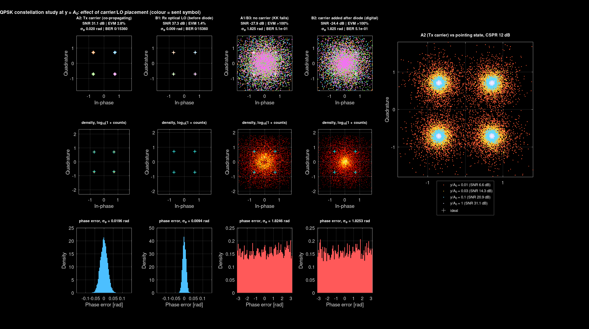

# OISL: Kramers–Kronig self-coherent receiver for optical inter-satellite links

Channel model, rate analysis and waveform simulation of a 1000 km LEO optical
inter-satellite link (OISL) that uses a **Kramers–Kronig (KK) self-coherent
receiver with a transmitter-side carrier**.

ECE F266 study project, BITS Pilani, Hyderabad Campus.

## The idea in one paragraph

The transmitter sends a strong CW carrier together with a single-sideband (SSB)
data signal, both from the same laser, in the same beam and polarisation. At
the receiver a single photodiode detects the intensity, and the KK relation
recovers the full complex field in DSP. Because carrier and data share one
laser and one path, laser phase noise, Doppler shift (up to ±9.9 GHz in LEO) and
polarisation rotation cancel in square-law detection. The receiver needs no local
oscillator laser, no frequency locking and no polarisation optics. The price is
the carrier-to-signal power ratio (CSPR): at κ = 12 dB only about 6 % of the
transmit power carries data, and κ must exceed the signal's peak-to-average power
ratio for KK to work.

## Main results (default parameters, QPSK, 1530 nm, P_T = 0.3 W, z = 1000 km)

| Quantity | Value |
|---|---|
| On-axis SNR, EDFA pre-amplifier / photodiode only | 31.1 dB / 18.6 dB |
| Ergodic rate, hard / soft decision | 13.18 / 13.44 Gb/s |
| Ergodic rate without pre-amplifier | 6.70 Gb/s |
| Sensitivity at HD-FEC (BER 3.8×10⁻³) | −28.6 dBm |
| Pointing shape parameter α (σ_s = 5.44 m > w_z = 4.87 m) | 0.20 |
| Time below QPSK sensitivity | 41 % |
| Waveform simulation vs analytic SNR | ≤ 0.1 dB down to 0.03·A₀, 0.4 dB at 0.01·A₀ |

Pointing jitter, not the KK receiver, limits reliability. Full tables,
validation runs and their settings are in [`docs/results.md`](docs/results.md).



*QPSK at y = A₀ for four carrier/LO placements: A2 transmitter carrier (used
throughout), B1 receiver optical LO, A1/B3 no carrier, B2 carrier added after
detection. Only a carrier present at the photodiode lets KK recover the phase.*

## Repository layout

```
OISL/
├── README.md                 this file
├── CHANGELOG.md              what changed and when
├── matlab/
│   ├── oisl_kk_txcarrier.m   main script: analytic model, Monte Carlo, all figures
│   ├── oisl_kk_channel.m     callable analytic model (for OptiSystem co-simulation)
│   ├── run_in_octave.m       runs the main script in GNU Octave
│   └── tests/
│       └── check_oisl_kk.m   regression checks for oisl_kk_channel.m
├── figures/                  figures written by oisl_kk_txcarrier.m (PLOT.save = true)
├── report/                   LaTeX source of the study report
│   ├── main.tex, chapter1-4.tex
│   ├── figs/                 figures the LaTeX includes (see report/REVISIONS.md)
│   └── REVISIONS.md          text changes needed to match the current code
├── docs/
│   ├── background.md         OISL system-model notes and base-paper summary
│   ├── kk_oisl_model.md      the KK-OISL model: equations and simulation chain
│   ├── results.md            reference numbers from the current code
│   └── open_questions.md     open questions, limitations, next steps
├── references/
│   └── README.md             papers used, with links
└── slides/                   NotebookLM summary decks
```

## How to run

**MATLAB** (written for R2018b or newer; no toolboxes required). This revision
was tested in GNU Octave 8.4 only. Run it once in MATLAB and compare with
`docs/results.md` before relying on it.

```matlab
cd matlab
oisl_kk_txcarrier          % edit the RUN.* switches at the top first
run tests/check_oisl_kk.m  % regression checks, about 10 s
```

Set `PLOT.save = true` to write every figure to `figures/` as PNG and PDF.
The Communications Toolbox is optional: if present, `PLOT.use_scatterplot = true`
also draws one overlay with `scatterplot()`.

**GNU Octave** (tested with 8.4). Octave needs script-local functions defined
before use, so run the wrapper:

```bash
cd matlab
octave --no-gui run_in_octave.m
```

Octave and MATLAB use different random-number generators, so Monte Carlo numbers
can differ in the second decimal place, and the measured PAPR can differ by more
than 1 dB (see `docs/results.md`).

**From other code / OptiSystem**

```matlab
r = oisl_kk_channel('PT', 0.3, 'z', 1500e3, 'mod', 'QPSK');
fprintf('SNR %.1f dB, ergodic rate %.2f Gb/s\n', r.snr_dB, r.rate_hard/1e9);
```

`oisl_kk_channel` covers the transmitter-carrier link analytically. Waveform-level
results (constellations, other carrier placements) come from the main script.

## What each RUN switch produces

| Switch | Output | Default |
|---|---|---|
| `RUN.budget` | Table 3.2 noise budget, rates and sensitivity (console) | on |
| `RUN.freq` | Fig 3.1 / 3.2: rate vs laser frequency over P_T | on |
| `RUN.snr` | Fig 3.3: rate vs SNR, hard and soft decision | on |
| `RUN.ybudget` | Fig 3.4: SNR contribution of each noise term vs y | on |
| `RUN.chanMC` | Fig 3.5a: pointing-loss CDF, channel Monte Carlo | on |
| `RUN.waveMC` | Fig 3.5b: end-to-end KK waveform simulation vs analytic | on |
| `RUN.constellation` | Fig 3.6: four carrier/LO placements, one window | on |
| `RUN.wd` | Fig 3.8: rate vs detector radius | off |
| `RUN.itu` | Fig 3.9: rate vs P_T at 1530 and 1565 nm | off |
| `RUN.cspr` | rate vs CSPR (analytic) | off |
| `RUN.cspr_wave` | SNR vs CSPR (waveform), the reference for the CSPR choice | off |
| `RUN.jitter`, `RUN.outage` | rate vs jitter σ_s0; outage rate vs ε | off |
| `RUN.mpkk` | Figs 3.10–3.13: CKK / GKK / MP-KK with an imposed front-end distortion | off |
| `RUN.csv` | CSV export of rate vs frequency and power | off |

`RUN.mpkk` is a sensitivity study only. The link model itself has no
nonlinearity or memory, so at the operating CSPR all four receivers give the
same result; the gain appears only with the imposed distortion. See
`docs/open_questions.md`.

## Status

- Analytic model and waveform simulation agree; regression checks pass.
- The report in `report/` predates the October 2026 code changes. Several
  numbers and statements need updating, listed in
  [`report/REVISIONS.md`](report/REVISIONS.md).
- Open items for discussion with the supervisor are in
  [`docs/open_questions.md`](docs/open_questions.md).

## References

Main sources: Shang, Zhang & Wong (IEEE TVT 2025) for the OISL channel and rate
model; Mecozzi, Antonelli & Shtaif (Optica 2016) for the KK receiver; Wen et al.
(Optics Express 2023) for MP-KK. Full list with links in
[`references/README.md`](references/README.md).

## Licence

<!-- TODO: no licence chosen yet. Without one, others may read but not reuse the
code. MIT is a common choice for academic code. -->
